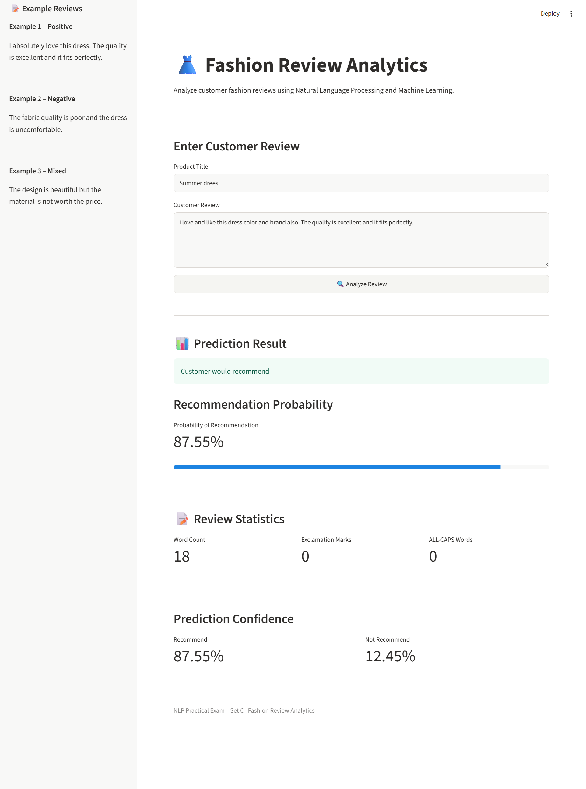
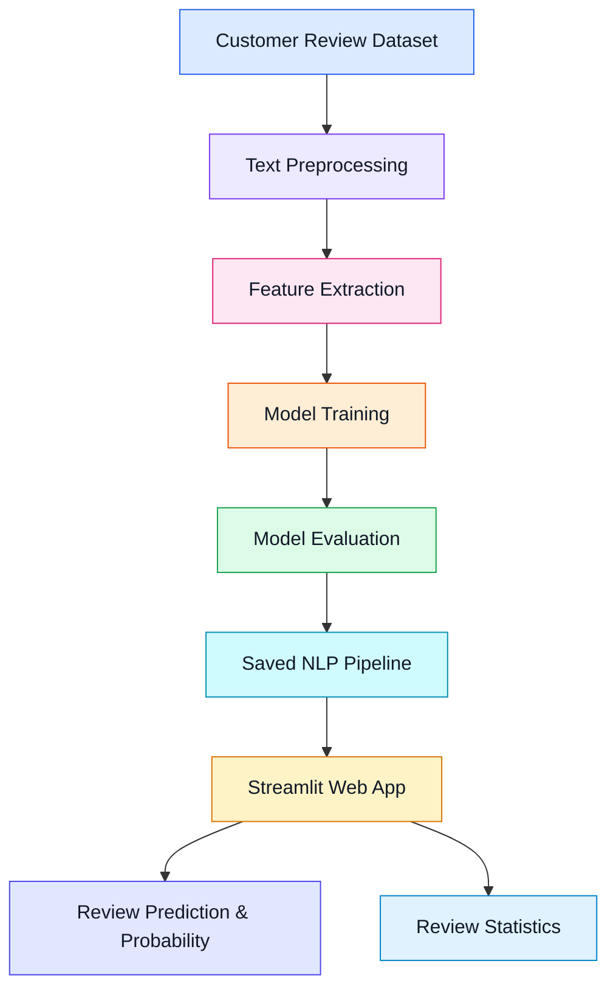

<div align="center">


<a href="https://git.io/typing-svg">
  
</a>

<br/>


<br/><br/>

**An end-to-end NLP project that analyses women's clothing reviews and predicts customer recommendation behaviour.**

</div>

---

## ✨ Project at a glance

Fashion Review Analytics turns unstructured customer feedback into an understandable prediction. A user enters a product title and review, selects **Analyze Review**, and the application displays the predicted recommendation class, probability, and simple review statistics.

<div align="center">

| Dataset records | Training records | Testing records | Not-recommended rate |
|:---:|:---:|:---:|:---:|
| **22,641** | **18,112** | **4,529** | **18.11%** |

</div>

## 🖥️ Application preview

The Streamlit interface includes example reviews, a product title field, a customer review input, prediction result, recommendation probability, review statistics, and prediction confidence.

**Add your application screenshot:** Create an `assets` folder in your repository, save your screenshot as `fashion-review-analytics.png`, and the preview below will display automatically.

<div align="center">
  
  <br/>
  <sub>Fashion Review Analytics — Streamlit application interface</sub>
</div>

### 🔎 Example prediction shown in the application

| Output | Example shown |
|---|---:|
| Prediction | Customer would recommend |
| Recommendation probability | **87.55%** |
| Not-recommend probability | **12.45%** |
| Review word count | 18 |
| Exclamation marks | 0 |
| ALL-CAPS words | 0 |

*These values are from the example visible in the application screenshot. A new review can produce a different prediction and probability.*

---

## 🎯 Business problem

Online fashion stores receive large volumes of written feedback. Reading every review manually takes time, and useful customer-satisfaction signals can be difficult to identify.

This project explores how NLP and machine learning can help classify a review as **recommended** or **not recommended**. The prediction can support review analysis and help identify feedback that may need closer attention. It is an analytical prototype, not a replacement for human customer-service review.

## 🧠 NLP workflow



## 🧰 Technologies and techniques

| Area | Tools / methods |
|---|---|
| Programming | Python |
| Data processing | Pandas, NumPy |
| Text processing | Regular Expressions, NLTK |
| Feature extraction | Bag of Words, TF-IDF, TF-IDF unigrams and bigrams |
| Word embeddings | Word2Vec Skip-gram |
| Classification | Logistic Regression |
| Evaluation | Accuracy, Precision, Recall, F1-score, ROC-AUC |
| Linguistic analysis | POS tagging |
| Rule-based analysis | Warning-word heuristic |
| Model persistence | Joblib, Gensim |
| Web application | Streamlit |

## 📊 Model evaluation

The dataset contains 22,641 records. The classification data was split into 18,112 training records and 4,529 testing records. The not-recommended class represents 18.11% of the dataset, so minority-class recall and F1-score are important alongside accuracy.

| Model | Accuracy | Class 0 Precision | Class 0 Recall | Class 0 F1 | ROC-AUC |
|---|---:|---:|---:|---:|---:|
| Baseline — Always Recommends | 0.8189 | 0.0000 | 0.0000 | 0.0000 | 0.5000 |
| Word2Vec Skip-gram + Logistic Regression | 0.8651 | 0.5837 | **0.8890** | 0.7047 | 0.9413 |
| **TF-IDF Unigrams + Bigrams + Logistic Regression** | **0.8881** | 0.6381 | 0.8817 | **0.7404** | **0.9463** |
| TF-IDF + Logistic Regression | 0.8794 | 0.6185 | 0.8720 | 0.7237 | 0.9441 |
| Bag of Words + Logistic Regression | 0.8834 | 0.6446 | 0.7939 | 0.7115 | 0.9257 |

### 🏆 Key findings

- **Best overall accuracy:** TF-IDF Unigrams + Bigrams + Logistic Regression — **88.81%**.
- **Best ROC-AUC:** TF-IDF Unigrams + Bigrams + Logistic Regression — **0.9463**.
- **Best Class 0 recall:** Word2Vec Skip-gram + Logistic Regression — **0.8890**.
- **Baseline limitation:** the always-recommends baseline achieved 81.89% accuracy but **0% Class 0 recall**.

The TF-IDF unigram-and-bigram model is the strongest overall choice by accuracy, Class 0 F1-score, and ROC-AUC. Word2Vec has a small advantage when the priority is identifying the not-recommended class.

## 🧪 Heuristic analysis and POS tagging

The warning-word heuristic was tested with different minimum match thresholds:

| Minimum warning matches | Accuracy | Class 0 Recall | Class 0 F1 |
|---:|---:|---:|---:|
| 1 | 0.8160 | 0.3077 | 0.3784 |
| 2 | 0.8240 | 0.0714 | 0.1287 |

A one-match threshold found more Class 0 reviews than a two-match threshold. The two-match rule had slightly higher accuracy, but much lower Class 0 recall. POS tagging was also applied to review text to identify grammatical categories.

## 🚀 Run locally

### 1. Clone the repository

```bash
git clone https://github.com/tushar123851/nlp-practical-exam-set-c.git
cd nlp-practical-exam-set-c
```

### 2. Create and activate a virtual environment (Windows)

```powershell
python -m venv .venv
.venv\Scripts\activate
```

### 3. Install dependencies

```bash
python -m pip install --upgrade pip
pip install -r requirements.txt
```

### 4. Start the Streamlit application

```bash
streamlit run app.py
```

Streamlit normally opens the application in your browser. If it does not, use the local URL printed in the terminal.

> Make sure `app.py`, `text_utils.py`, the saved model files, and all required dependencies are present before running the app. The exact imports and package versions should match your implementation.

## 📁 Project structure

```text
nlp-practical-exam-set-c/
│
├── app.py
├── text_utils.py
├── requirements.txt
├── README.md
├── NLP_Practical_Exam_Set_C.ipynb
│
├── assets/
│   └── fashion-review-analytics.png
│
├── models/
│   ├── best_nlp_pipeline.pkl
│   └── word2vec_skipgram.model
│
├── outputs/
│   ├── step7_classification_results.csv
│   ├── step7_project_summary.csv
│   ├── heuristic_results.csv
│   └── pos_tagging_results.csv
│
└── reports/
    └── summary_report.md
```

*Keep only files that actually exist in your repository. Update filenames and folders to match your actual project.*

## 🔮 Future improvements

- Improve handling of Hinglish and multilingual customer reviews.
- Explore transformer-based text classification models.
- Improve complaint phrase extraction and customer-issue analysis.
- Tune the classification threshold for better minority-class detection.
- Add more review-level analytics and visual summaries.
- Test the application with a wider range of real customer reviews.
- Add automated tests and reproducible dependency versions before deployment.

## 👨‍💻 Author

<div align="center">

### **Tushar Vala**

**Data Analyst | AI/ML Developer | NLP Enthusiast**


<br/><br/>


**Built with Python, NLP, Machine Learning and Streamlit.**

</div>

